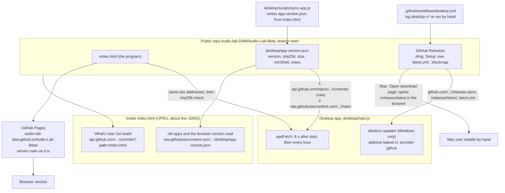

# Update feed plan (task S1)

Written 26 Nov 2026 for AudioLab Pro v0.219. **Plan only: no code, settings, CI or accounts were changed, and the repo is still public.**
It follows `docs/glass-engine-plan.md` sections 2.6, 2.7 and 3 (task S1).

Marks used below: **[checked]** = read in this repo or on an official page opened on 26 Nov 2026; **[not confirmed]** = could not be verified on an opened page and must be tested before relying on it. Prices are in US dollars unless marked.

## 1. Summary

- Today every update comes from the public GitHub repo. If the repo is switched to private, every installed app stops updating without any message, the Windows app updater stops, the browser version goes offline, and the "what's new" list and three links in the app go dead.
- Recommended: an own address on **Cloudflare** (a domain, R2 for the installers, static hosting for the browser version, the version file and the program file). Cost: the domain only, about 10 dollars a year for a .com. A **public "releases" repo on GitHub** is the second address, at no cost.
- Signing: **Apple Developer Program, 99 dollars a year**, is worth doing now. It removes the Mac warning and allows the normal Mac updater. For Windows the right choice depends on the country and on whether there is a company (section 6).
- Two things the short order in plan 2.7 does not say, and that decide the rollout:
  1. **Mac users must install one new app by hand** before the repo goes private. The address is inside the app (`desktop/main.js`), not inside the program file, and the unsigned Mac app cannot replace itself.
  2. **Moving the browser version to a new address leaves saved projects behind.** Browsers keep projects per address. The old page has to stay up as a "move your projects" page, or the address has to stay the same (setup C).
- Five decisions are needed from the user (section 10).

## 2. How updates work today [checked]

There are two kinds of update:

- **The program** is the single file `index.html` (3.58 MB). The desktop app carries a copy and can download a newer one into the user-data folder.
- **The app around it** (Electron: `main.js`, `preload.js`) is only replaced when the version file asks for it (`minShell`, now 0.147.0).



Details that matter for the move:

| What | Where | Reads from |
|---|---|---|
| Version file and program file | `desktop/main.js` lines 346 to 371 (`UPD_BASE`, `UPD_API`, `UPD_RAW`, `updFetch`) | GitHub API first, raw.githubusercontent.com second. `AL_UPDATE_BASE` already lets tests point at a local server |
| Check of the download | `updDo`, line 397 | sha256 from the version file, fetched from the same place as the file |
| Windows app updater | `setupUpdater`, line 408; `build.publish` in `desktop/package.json` | electron-updater 6.3.9, provider `github`. It uses github.com web addresses, not the rate-limited API |
| Mac app | `mac.identity: null`, `afterPack.js` signs ad hoc, target dmg only | no updater; opens the Releases page |
| Old apps and browser | `index.html`, `UPDU.man`, `UPDU.com`, `UPDU.rel` | raw.githubusercontent.com, GitHub API, Releases page |
| Menu links | `main.js` lines 14, 335, 336 | repo page and Releases page |
| Browser version | GitHub Pages from `main`, root folder; `coi-serviceworker.js` adds the isolation headers Pages cannot send | the repo |
| Not affected | AI voice and stem-splitter models (huggingface.co), onnxruntime-web and lamejs (jsdelivr), Inter (Google Fonts) | other hosts |

### What breaks if the repo is simply switched to private

| Thing | Result |
|---|---|
| Program updates in every installed app | The API and raw addresses answer 404. The app keeps running its current version for good. Nothing tells the user unless they open the update window, which then shows an error |
| Windows app updater | 404, the error is swallowed (`autoUpdater.on('error', () => {})`) |
| Mac "Open download page", menu "Releases", "AudioLab Pro on GitHub" | 404 page in the browser |
| "What's new" list | empty (the commits API answers 404) |
| Browser version | Offline. On the free plan Pages is unpublished when a repo goes private. Projects saved in the browser at that address can no longer be reached through the app |
| CI builds | Still work, but Actions minutes on private repos are metered (macOS runners count ten times) [not confirmed for the current allowance; check the billing page before step 4] |

## 3. Recommended setups

All three keep the files readable by anyone who has the address. That is unavoidable: an app that updates without a login needs a public file. What becomes private is the source history, the tools, the tests and the docs. See 5.5 for the minified build.

Traffic used for the estimates: each user downloads 2 installers of 200 MB and 10 program files of 3.6 MB a month and asks for the version file 720 times. That is 0.44 GB and 732 requests per user per month.

| | A. Cloudflare, own domain (recommended) | B. Public "releases" repo on GitHub | C. Stay on GitHub Pages from the private repo |
|---|---|---|---|
| Version file and program file | Workers static assets (or Pages) on the own domain | GitHub Pages of the releases repo | GitHub Pages of the private repo, deployed by Actions |
| Installers and `latest.yml` | R2 bucket on a sub-domain | GitHub Releases of the releases repo | needs B for this part |
| Browser version | same static site, real isolation headers through `_headers` | Pages of the releases repo, service worker as today | same address as today |
| Per month, 100 / 1,000 / 10,000 users | 0 / 0 / 0, plus the domain | 0 / 0 / 0 | 4 per member of the organisation (GitHub Team) |
| Per year | **about 10.5** (.com) or about 14 (.app) | **0** | **48** per member |
| Browser projects | new address: needs the "move your projects" page (5.6) | new path but same site name `audio-lab-daw.github.io`, so saved projects stay reachable [not confirmed; test in step 5] | nothing moves |
| Weak points | one more account; domain renewal | GitHub's terms forbid Pages as free hosting for a business; no own headers; the address still says GitHub | Pages has a 100 GB a month soft limit and the same terms; the published site is public anyway; the org needs a paid plan for as long as it runs |

Facts behind the table [checked unless marked]:

- **Cloudflare R2**: 10 GB storage, 1 million writes and 10 million reads a month free; then 0.015 per GB a month; downloads (egress) are free. A custom domain needs the domain to be in the same Cloudflare account. The `r2.dev` address is rate-limited and for development only.
- **Cloudflare Workers static assets and Pages**: requests for static files are free and unlimited; 25 MiB per file, 20,000 files; a `_headers` file sets headers (the repo already has one). Installers do not fit, hence R2. Cloudflare now tells new projects to start with Workers, Pages is not withdrawn.
- **Domain at Cloudflare Registrar** (sold at cost; prices are only shown in the dashboard, these are from third-party trackers, October 2026): .com 10.46 a year, .app 14.20 a year (8.20 the first year), .audio 100.20 a year.
- **GitHub Releases**: files under 2 GiB, no limit on bandwidth stated, download addresses are not part of the rate-limited API.
- **GitHub Pages**: 1 GB site, 100 GB a month soft limit; a site published from a private repo is still public; sites with access control need Enterprise Cloud. Pages from a private repo needs Pro (personal accounts), Team or Enterprise. The repo belongs to the organisation Audio-lab-DAW, so it would be Team, 4 per user a month.
- Setting isolation headers on an R2 custom domain through response header rules is [not confirmed]; the plan does not need it, because the browser version sits on the static site.

Looked at and not recommended:

| Option | Why not |
|---|---|
| Backblaze B2 | 0 only when put behind Cloudflare, whose free CDN terms allow limiting "large files"; direct it costs 0.35 / 4.27 / 43.51 a month. R2 does the same with less setup |
| AWS S3 with CloudFront | Flat-rate plan: 0 up to 100 GB a month, then 15 a month (180 a year). Pay as you go: about 0.07 a month until 1 TB, about 286 a month at 10,000 users. More parts to set up and no gain here |
| Netlify | Credit plan: about 14 / 70 / 600 a month with the installers; 10 MB per file advised |
| Vercel | Free plan cannot hold the installers (100 MB upload limit); Pro about 20 / 67 / 669 a month |
| Private GitHub provider of electron-updater | needs a GitHub token inside every installed app; the makers call it unsuitable for all users |

**Proposal: A as the first address and B as the second.** The app then has two live addresses on two companies, the cost is the domain, and if one of them fails the other still delivers updates. If no domain and no new account are wanted now, B alone works and A can be added later without a new app (the list of addresses can be extended by a program update only if it lives in the version file; see 7.1).

## 4. Rollout, in the order of plan 2.7

Each step lists what is done, what can break and how to test it. Nothing in a step is irreversible until step 4.

### Step 0. Decisions and accounts (user)

Choose the setup, the domain name and the certificates (section 10). Create the Cloudflare account, buy the domain, create the R2 bucket and an API token limited to that bucket and the static site. Enrol in the Apple Developer Program if wanted. Put the tokens into GitHub Actions secrets. No app change.

### Step 1. Own address, filled next to the old one

Done by a new workflow (7.5); the old feed stays exactly as it is.

Proposed layout (the examples use `audiolab.example`):

```
https://app.audiolab.example/                      browser version (step 5)
https://app.audiolab.example/feed/app-version.json version file (short cache)
https://app.audiolab.example/feed/app-version.json.sig   its signature (5.4)
https://app.audiolab.example/feed/program/0.220/index.html   program file, one folder per version, cached for good
https://app.audiolab.example/feed/notes.json       the "what's new" list
https://dl.audiolab.example/win/latest.yml, Setup .exe, .blockmap     R2
https://dl.audiolab.example/mac/…dmg (and latest-mac.yml, .zip once signed)
https://app.audiolab.example/download              plain page with the two newest installers
```

Rules: upload the program file first and the version file last, so an app never sees a version whose file is not there yet. Version file: `Cache-Control: no-cache`. Versioned files: `max-age=31536000, immutable`.

| Can break | Test |
|---|---|
| Wrong content type or a compressed body that changes the bytes, so the sha256 no longer matches | `curl` each file, compare `sha256sum` with the version file; run the app with `AL_UPDATE_BASE=https://app.audiolab.example/feed/` (exists today) and update from an older program |
| A cache keeps an old version file | change the file, fetch it again from two networks, expect the new one within a minute |
| Installer download cut off or no range requests | `curl -r 0-99 -I` on the `.exe` answers 206; download the whole file and compare its sha512 with `latest.yml` |
| Workflow uploads half a release | the workflow uploads the version file only after every other file answered 200 |

### Step 2. An app and a program that read the new address first and the old one second

Two releases belong together:

1. **Program release N** (index.html): the page's own reader (`UPDU`) gets the new addresses first and the old second; the "what's new" list reads `notes.json` first; and a new notice: when the page runs inside an app older than N, it shows the existing "newer app needed" window with a link to the new download page. **`MIN_SHELL` is not raised for this release**, so every existing app receives it through the old feed.
2. **App release N** (`main.js`, `package.json`): the list of addresses in `updFetch` becomes new, public releases repo, old API, old raw. The Windows updater is built with the new address first and falls back to the old one. The menu and "Open download page" links point at the new download page. If the Mac certificate is ready, this is also the first signed and notarised Mac app with the normal updater (section 6); doing both in one app spares Mac users a second manual install.

Windows apps replace themselves. **Mac users are asked once to download and install app N by hand**, as with every app update so far.

| Can break | Test |
|---|---|
| New address down: the app must fall through to the old one without a long wait | point the first address at a dead host: update still arrives; time for the whole check stays under the existing limits (15 s for the version file) |
| Old address gone (the future): the app must work on the new one alone | block github.com, api.github.com and raw.githubusercontent.com in the test: update arrives |
| Windows: the fallback pattern (`setFeedURL`, then check again) is not a documented one; it was read from the 6.3.9 source [checked in source, not in docs] | install app N-1 from a test feed, publish N on the new feed only, then on the old feed only; both must update. Watch for a double download |
| Windows: first signed update over an unsigned app | goes through on electron-updater 6.3.9 (verification is skipped when the installed app has no publisher name). Test once on a clean Windows machine |
| Mac: signed app over the ad-hoc one | same bundle id, so projects and settings stay; macOS may ask for the microphone permission again. Test on the user's Mac |
| Old apps never show the notice | start app 0.219 against program N: the notice appears and the link opens the new download page in the browser |
| Existing tests | `tools/ui-tests/updwin.py`, `taskAH_electron.js`, `taskAO_electron.js`, plus a new `taskS1_feed_electron.js` with two local servers (first answers, first dead, both dead, wrong signature, older version offered) |

### Step 3. Wait

There is no telemetry, so "everyone has it" cannot be measured exactly. Use what exists:

- Cloudflare shows the number of requests for `feed/app-version.json`; each running app N asks once an hour. GitHub shows download counts per release file for app N.
- Keep both feeds complete for at least 4 weeks and at least 2 program releases, so the fallback order is proven in real use.
- Before step 4, publish one last program release through the old feed whose update note says where the new download page is.

Whoever has not opened the app in that time keeps a working app that no longer updates. When they next get a program that is N or newer they see the notice; if they never updated to N they see nothing until they check by hand and get an error. That is the reason for the wait and for the note in the last old-feed release.

### Step 4. Switch the repo to private (user, in the repository settings)

Before the switch, check: new feed has the current version; app N or newer is the newest on both feeds; the releases repo (if B is used) has the installers; the Actions allowance for private repos is understood; the Pages site is handled (step 5 prepared, or setup C).

| Can break | Test (first hour after the switch) |
|---|---|
| Old addresses now answer 404 for everyone | expected. Start app N: update check says "current" or installs; start an old app: it runs, the check shows an error |
| Pages site goes offline at once on the free plan | have step 5 ready on the same day, or use setup C |
| Release assets of the private repo are no longer public | the download page and `latest.yml` must point at R2 or the releases repo only; open every link on the download page in a private window |
| Workflows that publish | run "Build desktop apps" once and see the files arrive on the new feed |
| Forks, stars and public links to the repo are lost; GitHub says some of this cannot be restored by switching back | accept before switching |

Rollback: switching back to public restores the old feed and Pages (after re-enabling Pages), which is why nothing in the old feed is deleted until the new one has run alone for a while.

### Step 5. Browser version from the same place, built with a minify step

- The workflow builds `dist/index.html` from `index.html` (5.5), and publishes it with `coi-serviceworker.js`, `manifest.webmanifest`, the icons and `_headers` to the static site. With real headers the service worker is no longer needed there, but it is harmless and can stay for the first release.
- The old Pages address becomes a small page (5.6) that offers to save every project to a file and then sends the visitor to the new address. With setup C this step is only the minify and deploy part and nothing moves.

| Can break | Test |
|---|---|
| Minifying changes behaviour | all `tools/ui-tests`, the engine tests, and the Fractals demo levels must be unchanged: Kick -9.75669 dB, Bass -25.48699 dB; an export must be bit-identical to the unminified build |
| Isolation headers missing, shared-memory engine off | on the new address `crossOriginIsolated` is true on first load without the reload |
| Projects left behind at the old address | create projects at the old address, run the move page, open the file at the new address |
| Output device choice, MIDI and microphone permissions are per address | the user grants them once again; say so on the move page |

## 5. Design notes

### 5.1 One version file, several addresses

Keep the format of `app-version.json` and add fields; old apps ignore fields they do not know. Proposed: `url` (where the program file for this version is, relative to the version file), `feeds` (an optional list of further base addresses the app may add to its list after checking the signature), `minShell`, `notes`, `published` (date). The program file gets a versioned path so a cached copy can never be the wrong version; the status "publishing" (file and version file out of step) then almost never occurs.

### 5.2 Reading order in the app

`updFetch` already tries a list of addresses in order and returns the first good answer. The change is the list: own address, releases repo, old API, old raw. Two rules to add: an address that answers but fails the signature or the sha256 counts as a failure and the next address is tried; and the version from a later address is only accepted if it is not older than what is installed.

### 5.3 Windows and Mac app updater (electron-updater)

- `build.publish` may hold several entries. The first is the address baked into the app; all entries that electron-builder can upload to receive the files. `generic` is never uploaded by electron-builder, so the workflow uploads to R2 itself (rclone or wrangler). An `s3` entry with an R2 `endpoint` and `acl: null` might do the upload, but that is [not confirmed] on electron-builder 25; the plain upload step is the safe choice.
- Files needed on the feed for Windows: `latest.yml`, the Setup `.exe` and its `.blockmap`. `latest.yml` carries a sha512 of the installer.
- Fallback at run time: `autoUpdater.setFeedURL(...)` followed by `checkForUpdates()` in a loop over the feeds, handling the failure in one place only. Read from the 6.3.9 source; the docs advise against calling `setFeedURL`, so this needs the tests in step 2.
- Range requests (smaller updates through the blockmap): R2, Cloudflare and CloudFront answer them; if a host does not, electron-updater downloads the whole installer instead.
- Mac: needs a signed app and a `zip` target next to the dmg (`latest-mac.yml` is made from the zip). Without a certificate the Mac stays on "download and replace".
- electron-builder 27 (not released; alpha on 20 Nov 2026) changes the signing options, wants https feeds, fails closed on Windows signature checks and brings its own signed update file and an `r2` provider. Stay on 25 or move to 26 for this work, and look at 27 again when it is stable.

### 5.4 Integrity

Today the sha256 comes from the same place as the file, so it catches a broken download and nothing else: whoever can replace `index.html` on the host can replace the version file too.

Proposed: sign the version file with an **Ed25519** key. The public key is written into `main.js`; the private key never reaches the host.

- Sign in the workflow: `crypto.sign(null, bytes, privateKey)` gives `app-version.json.sig`. In the app: `crypto.verify(null, bytes, publicKey, signature)` on the raw bytes before parsing, then the sha256 of the program file as today. (Node's `crypto` supports Ed25519 with the algorithm argument set to null. [checked])
- Refuse a version file that is older than the installed program (stops someone replaying an old, signed file).
- Put two public keys into the app (one in use, one spare kept offline) so the key can be changed without stranding anyone.
- Where the private key lives: a GitHub Actions secret is the practical choice and protects against a hacked host or bucket; it does not protect against a hacked GitHub account. A key kept only on the user's Mac would, but then every release needs the Mac. Proposal: Actions secret now.
- The installers are covered by the sha512 in `latest.yml` and, once signed, by Apple's and Microsoft's signatures; on Windows a signed app refuses an update signed by someone else.
- The browser version cannot be protected this way: a browser runs what the host sends. This is one more reason to keep the host account locked down (two-factor sign-in, a token limited to the one site and bucket).

### 5.5 Minified build

- Tool: `esbuild` (transform with `--minify`, no bundling, no format option) or `terser` on each inline script block, and a CSS minifier on the style block; `html-minifier` 5 (the former html-minifier-next, merged back on 3 Nov 2026) or `html-minifier-terser` can drive both. Top-level names must stay as they are, which is the default of both tools when not bundling: the page has inline handlers and several script blocks that call each other by name.
- Risks to test: worklet and worker code built from `function.toString()`, anything that reads a function's `.name`, `new Function`. Code kept in strings is left alone.
- Keep the source map out of the published folder.
- Expected size: no measured figure; roughly a third to a half smaller before compression is typical for hand-written code. Measure in the first run.
- How closed it is: a minified file can be tidied up by any formatter; local names are lost, the logic, the texts and the top-level names stay. Obfuscators cost speed, which this app cannot spare, and can be undone too. Plan 2.6 stays true: private repo plus desktop app is "mostly closed".
- Decision 5 in section 10: whether the desktop apps should also carry and download the minified file. If yes, `sync-app.js` computes the sha256 of the minified file and the Fractals and export tests run on that build.

### 5.6 Browser projects when the address changes

Browsers keep IndexedDB, localStorage and the private file store per site (scheme, host, port). `audio-lab-daw.github.io` and a new domain are different sites, so projects saved in the browser do not follow. GitHub Pages cannot send a real redirect.

- Keep the old Pages site as a small page that lists the projects it finds, saves them as `.audiolab` files, and then links to the new address. This needs either setup C's paid plan for the old repo or a public repo that serves the same address. The address is `…github.io/Audio-Lab-Beta/`, tied to the repo name, so the public releases repo would have to take over that name (the private repo is renamed first). [not confirmed that Pages re-publishes cleanly at the same address after such a rename; test with a throw-away repo first]
- Under setup B without that rename the site name stays `audio-lab-daw.github.io` and only the path changes, so the same storage should be reachable from the new path. [not confirmed; test in step 5]
- The desktop app is not affected: it uses its own address scheme and user-data folder.

## 6. Signing

### 6.1 Mac

| | Today (ad hoc) | Developer ID, notarised |
|---|---|---|
| Cost | 0 | Apple Developer Program, 99 a year (local currency where Apple offers it) |
| Who | anyone | an individual anywhere, under their legal name; a company needs a legal entity and a D-U-N-S number |
| First start | blocked; since macOS Sequoia the right-click Open no longer works; the user must go to System Settings, Privacy & Security, Open Anyway | normal "downloaded from the internet" question |
| Updates | by hand | the normal updater (Squirrel.Mac needs a signed app) |

What it takes: a "Developer ID Application" certificate exported as `.p12` into Actions secrets, an App Store Connect API key for notarisation (`APPLE_API_KEY`, `APPLE_API_KEY_ID`, `APPLE_API_ISSUER`), hardened runtime on, and an entitlements file with `allow-jit`, `disable-library-validation` (onnxruntime loads its own library) and `com.apple.security.device.audio-input`. Every binary inside must be signed, including `bin/alvol` and the onnxruntime files; the notarisation log names any that is not. `CSC_LINK` and `CSC_KEY_PASSWORD` as the names of the certificate secrets are the long-standing ones [not confirmed on a page today].

### 6.2 Windows

Microsoft's own page (May 2026): an EV certificate no longer removes the SmartScreen warning at once. Any signature shows the publisher's name, and the "Windows protected your PC" warning fades as downloads build up reputation, which can take weeks and hundreds of installs. An unsigned installer starts from zero with every release.

| Option | Per year | Who can get it | From GitHub Actions |
|---|---|---|---|
| Unsigned (today) | 0 | anyone | yes; the user clicks More info, Run anyway; updates work |
| Azure Artifact Signing (the new name of Trusted Signing), Basic | about 120 (9.99 a month, 5,000 signatures) | organisations in the US, Canada, EU, UK and some others; **individuals only in the US or Canada** | yes, built into electron-builder from 25.1 (`win.azureSignOptions`) |
| SSL.com certificate with eSigner | about 309 (certificate 129 + eSigner 180 for 20 signings a month, 1 each extra) | individuals too [price of the individual certificate not confirmed] | yes, official action; one build signs several files, so 20 a month is tight |
| Certum Standard, cloud | from 209 EUR | individuals [documents not confirmed] | no official unattended way |
| DigiCert with KeyLocker | 996 | organisations | yes |
| SignPath Foundation | 0 | open-source projects only | not for a closed app |

Rules that apply to all bought certificates: the private key must sit on certified hardware or a cloud service (no plain file in CI since June 2023), and certificates last at most 460 days since March 2026.

Whether a sole trader in the EU counts as an organisation for Azure is [not confirmed]; two public reports from 2026 say validation failed. A 3-year business history rule from the 2025 preview is not in today's documents [not confirmed either way].

One trap for later: once a signed Windows app is installed, electron-updater refuses updates signed under a different name. Changing from a personal name to a company name needs one bridging release that lists both names.

### 6.3 Proposal

- **Now:** Apple Developer Program (99 a year), with the first signed Mac app being app N of step 2.
- **Windows:** if the user is in the US or Canada, or has a company in a listed country: Azure Artifact Signing (about 120 a year). Otherwise stay unsigned during the beta (updates work, one extra click on first install) and decide again when there is a company or enough users to justify about 309 a year.

## 7. Code changes needed later, file by file

None of this was done. Line numbers are for v0.219.

### 7.1 `desktop/main.js`

- Lines 346 to 348: replace `UPD_API` and `UPD_RAW` by a list `UPD_FEEDS` (own address, releases repo, old API with its `Accept` header, old raw). `AL_UPDATE_BASE` stays and may hold several addresses separated by commas, for tests.
- `updFetch` (355): loop over the list; return which address answered. New `updManifest()`: fetch `app-version.json` and `app-version.json.sig` from the same address, verify with the public keys (new constants `UPD_KEYS`), reject and try the next address when the check fails. The old GitHub addresses carry no signature; accept them unsigned only until step 4, behind one constant that the release after step 4 removes.
- `updDo` (379): take the program file from `m.url` when present, from the address that delivered the version file; keep the sha256 check; refuse a version file older than the installed program; add the reason `signature` to `updWhy`.
- `setupUpdater` (408): build the list of feeds for electron-updater (`generic` at `dl.<domain>/win`, then `github` at the releases repo, then the old repo) and a `appCheck()` that walks it with `setFeedURL` and `checkForUpdates`; use it in the three places that call `autoUpdater.checkForUpdates()` (438, 446, 490). Once the Mac app is signed, drop `!isMac` here and in `needNewAppDialog`.
- Lines 14, 335, 336, 448, 490: `RELEASES` becomes the new download page; the "AudioLab Pro on GitHub" menu item goes or points at the website.
- Report the address in use in `al:update-status`, so the update window and the tests can show it.

### 7.2 `desktop/preload.js`

No change needed. `updateStatus` already passes through whatever `main.js` reports.

### 7.3 `desktop/package.json`

- `build.publish`: first entry `{ "provider": "generic", "url": "https://dl.<domain>/win" }`, second `{ "provider": "github", "owner": "Audio-lab-DAW", "repo": "<releases repo>" }`. Remove the entry for the source repo in the release after step 4.
- Scripts: `release:*` build with `--publish never` when the workflow uploads to R2 itself, or keep `always` for the GitHub entry only.
- Mac, when the certificate exists: remove `"identity": null`, set `"hardenedRuntime": true`, add `"entitlements"` and `"entitlementsInherit"`, add the `zip` target, set `"dmg.writeUpdateInfo"` as needed, list `bin/alvol` under `mac.binaries` if the notarisation log asks for it.
- Windows, when signing exists: `win.azureSignOptions` (publisher name, endpoint, account, certificate profile) or the signing step of the chosen service.
- Dev dependencies for the minify step (`esbuild` or `terser`, an HTML minifier).

### 7.4 `desktop/scripts/sync-app.js` and `afterPack.js`

- `sync-app.js`: write the new fields (`url`, `published`, optional `feeds`); when the desktop app is to carry the minified file, copy `dist/index.html` and hash that. Keep writing `desktop/app-version.json` at the same place until step 4 so the old feed stays valid.
- New `desktop/scripts/build-web.js`: minify `index.html` into `dist/`. New `desktop/scripts/sign-manifest.js`: sign the version file with the key from the environment. New `desktop/scripts/make-notes.js`: write `notes.json` from `docs/backlog-log.md` or the update notes, to replace the commits list.
- `afterPack.js`: skip the ad-hoc signing when a real identity is present.

### 7.5 `.github/workflows/`

- New `feed.yml`, on a push to `main` that changes `index.html` or `desktop/app-version.json`: run the tests that work headless, build the web folder, sign the version file, upload program file, then `notes.json`, then the version file and signature; deploy the static site. Secrets: Cloudflare API token and account id, the Ed25519 private key.
- `desktop.yml`: after the build, upload installers, `latest.yml` and blockmaps to R2 and create the release on the releases repo (needs a token for that repo, as `GITHUB_TOKEN` only covers its own); add the Apple and Windows signing secrets; remove `CSC_IDENTITY_AUTO_DISCOVERY: 'false'` for the Mac job once the certificate exists.
- Old Pages address: either a Pages workflow that deploys the move page (setup C or the renamed public repo), or nothing.

### 7.6 `index.html`

One serial task, under the usual rules for this file (pull first, version bump, tests, Fractals levels).

- `UPDU` (about line 10952): `man` becomes a list (new address, releases repo, old raw); `com` becomes `notes.json` with the commits list as the second try until step 4; `rel` becomes the new download page. `updLook` and the notes loader walk the lists.
- New notice for apps older than app N: reuse the "newer app needed" window (`audiolabHost.appUpdate`) with the new download link; shown at most once a day.
- Any text that names GitHub as the place for downloads.

### 7.7 Other files

- `README.md`, `desktop/README.md`: new addresses, the release routine with the new workflow, the signing set-up.
- `_headers`: add `Cache-Control` rules for `/feed/*`; keep the isolation headers.
- `tools/ui-tests/`: `taskS1_feed_electron.js` (step 2 list), `taskS1_web.py` (minified build equals the plain build in the existing tests), and a check script for the live feed (hashes, signature, headers, range requests) that the workflow runs after each upload.
- New `web/old-address/index.html`: the "move your projects" page.

## 8. Costs in one place

| Item | Per month | Per year |
|---|---|---|
| Setup A: Cloudflare R2 and static site | 0 | 0 |
| Domain, .com at cost (.app about 14) | about 0.87 | about 10.5 |
| Setup B: public releases repo | 0 | 0 |
| Setup C: GitHub Team for the organisation, per member | 4 | 48 |
| Apple Developer Program | 8.25 | 99 |
| Windows: unsigned | 0 | 0 |
| Windows: Azure Artifact Signing, if eligible | 9.99 | about 120 |
| Windows: SSL.com with eSigner | about 26 | about 309 |
| **A + B, Apple, Windows unsigned (proposal outside the US and Canada)** | **about 9** | **about 110** |
| **A + B, Apple, Azure (proposal where Azure is open to the user)** | **about 19** | **about 230** |

## 9. What this plan could not settle

- The user's country and whether there is a company; it decides the Windows option.
- The current free Actions minutes for private repos, and how many a release build uses.
- Items marked [not confirmed] above: the `s3` upload to R2 from electron-builder 25, header rules on R2 domains, Pages behaviour after a repo rename, storage at a new path on the same Pages site, the exact macOS message when an ad-hoc app is offered a signed update, the price of an individual certificate at SSL.com, and whether GitHub throttles its release download addresses.
- Real minified size and whether minifying changes any sound: to be measured in step 5.

## 10. Decisions for the user

1. **Host:** A (Cloudflare with an own domain, B as second address), B alone (free, no domain, GitHub only), or C (pay GitHub 4 a month per member and keep the browser address)?
2. **Domain:** which name and ending (.com about 10.5 a year, .app about 14, .audio about 100)?
3. **Apple certificate now** (99 a year)? If yes, app N is the first signed Mac app and Mac users install by hand one last time.
4. **Windows:** which country, and is there a company? Then: Azure (about 120 a year, if eligible), SSL.com (about 309 a year), or unsigned for now.
5. **Minified file for the desktop apps too**, or only for the browser version? And is "save your projects to files at the old address, open them at the new one" acceptable for browser users, or should the browser address stay (setup C)?

## 11. Sources (opened on 26 Nov 2026 by research helpers)

Hosting: [R2 pricing](https://developers.cloudflare.com/r2/pricing/), [R2 limits](https://developers.cloudflare.com/r2/platform/limits/), [R2 public buckets](https://developers.cloudflare.com/r2/buckets/public-buckets/), [R2 S3 API](https://developers.cloudflare.com/r2/api/s3/api/), [Pages limits](https://developers.cloudflare.com/pages/platform/limits/), [Workers static assets billing](https://developers.cloudflare.com/workers/static-assets/billing-and-limitations/), [Workers static assets headers](https://developers.cloudflare.com/workers/static-assets/headers/), [Cloudflare range requests](https://developers.cloudflare.com/cache/reference/range-requests/), [Cloudflare response header rules](https://developers.cloudflare.com/rules/transform/response-header-modification), [Cloudflare service terms](https://www.cloudflare.com/en-au/service-specific-terms-application-services), [Cloudflare Registrar](https://www.cloudflare.com/products/registrar/), [domain prices, third party](https://costgoat.com/pricing/cloudflare-domains), [.audio price, third party](https://domainoffer.net/tld/audio/cloudflare), [Backblaze B2 pricing](https://www.backblaze.com/cloud-storage/pricing), [B2 through Cloudflare](https://www.backblaze.com/docs/cloud-storage-deliver-public-backblaze-b2-content-through-cloudflare-cdn), [CloudFront pricing](https://aws.amazon.com/cloudfront/pricing/), [CloudFront pay as you go](https://aws.amazon.com/cloudfront/pricing/pay-as-you-go/), [S3 pricing](https://aws.amazon.com/s3/pricing/), [CloudFront range requests](https://docs.aws.amazon.com/AmazonCloudFront/latest/DeveloperGuide/RangeGETs.html), [Netlify pricing](https://www.netlify.com/pricing/), [Netlify credits](https://docs.netlify.com/manage/accounts-and-billing/billing/billing-for-credit-based-plans/how-credits-work/), [Vercel pricing](https://vercel.com/pricing), [Vercel limits](https://vercel.com/docs/limits).

GitHub: [About releases](https://docs.github.com/en/repositories/releasing-projects-on-github/about-releases), [Linking to releases](https://docs.github.com/en/repositories/releasing-projects-on-github/linking-to-releases), [REST rate limits](https://docs.github.com/en/rest/using-the-rest-api/rate-limits-for-the-rest-api), [rate limits for unauthenticated requests, May 2025](https://github.blog/changelog/2025-05-08-updated-rate-limits-for-unauthenticated-requests/), [Pages limits](https://docs.github.com/en/pages/getting-started-with-github-pages/github-pages-limits), [What is GitHub Pages](https://docs.github.com/en/pages/getting-started-with-github-pages/what-is-github-pages), [Pages visibility](https://docs.github.com/en/pages/getting-started-with-github-pages/changing-the-visibility-of-your-github-pages-site), [plans](https://docs.github.com/en/get-started/learning-about-github/githubs-plans), [pricing](https://github.com/pricing), [contents API](https://docs.github.com/en/rest/repos/contents), [Pages redirects note](https://til.simonwillison.net/github/github-pages).

Updater: [electron-builder publish](https://www.electron.build/docs/publish), [auto update, v26](https://www.electron.build/v26/docs/features/auto-update), [generic options](https://www.electron.build/docs/api/builder-util-runtime.Interface.GenericServerOptions), [security, v27](https://www.electron.build/docs/features/security), [v26 to v27](https://www.electron.build/docs/migration/v26-to-v27), [electron-updater 6.3.9 AppUpdater source](https://raw.githubusercontent.com/electron-userland/electron-builder/electron-updater%406.3.9/packages/electron-updater/src/AppUpdater.ts), [NsisUpdater source](https://raw.githubusercontent.com/electron-userland/electron-builder/master/packages/electron-updater/src/NsisUpdater.ts), [Electron autoUpdater](https://www.electronjs.org/docs/latest/api/auto-updater), [Electron updates tutorial](https://www.electronjs.org/docs/latest/tutorial/updates).

Integrity and build: [Node crypto](https://nodejs.org/api/crypto.html), [minisign](https://jedisct1.github.io/minisign/), [The Update Framework, security](https://theupdateframework.io/docs/security/), [Doyensec on safe Electron updates](https://blog.doyensec.com/2026/02/16/electron-safe-updater.html), [esbuild API](https://esbuild.github.io/api/), [terser options](https://terser.org/docs/options/), [html-minifier-terser](https://github.com/terser/html-minifier-terser), [html-minifier 5](https://meiert.com/blog/html-minifier-next-updates-2/), [MDN COEP](https://developer.mozilla.org/en-US/docs/Web/HTTP/Reference/Headers/Cross-Origin-Embedder-Policy), [MDN storage per origin](https://developer.mozilla.org/en-US/docs/Web/API/Storage_API/Storage_quotas_and_eviction_criteria).

Signing: [Apple enrolment](https://developer.apple.com/support/enrollment/), [Apple notarisation](https://developer.apple.com/documentation/security/notarizing-macos-software-before-distribution), [Apple on Sequoia and Gatekeeper](https://developer.apple.com/news/?id=saqachfa), [Open Anyway steps](https://support.apple.com/guide/mac-help/open-a-mac-app-from-an-unidentified-developer-mh40616/mac), [audio input entitlement](https://developer.apple.com/documentation/bundleresources/entitlements/com.apple.security.device.audio-input), [electron-builder Mac signing, v26](https://www.electron.build/v26/docs/features/code-signing/code-signing-mac), [electron-builder Windows signing, v26](https://www.electron.build/v26/docs/features/code-signing/code-signing-win), [Azure Artifact Signing quickstart](https://learn.microsoft.com/en-us/azure/artifact-signing/quickstart), [Artifact Signing FAQ](https://learn.microsoft.com/en-us/azure/artifact-signing/faq), [SmartScreen reputation](https://learn.microsoft.com/en-us/windows/apps/package-and-deploy/smartscreen-reputation), [Artifact Signing pricing](https://azure.microsoft.com/en-us/pricing/details/artifact-signing/), [rename and general availability](https://techcommunity.microsoft.com/blog/microsoft-security-blog/-/4482789), [CA/B Forum ballot CSC-31](https://cabforum.org/2025/11/17/ballot-csc-31-maximum-validity-reduction), [DigiCert key storage rule](https://knowledge.digicert.com/alerts/code-signing-changes-in-2023), [DigiCert prices](https://digicert.com/signing/compare-code-signing-certificates), [Certum prices](https://shop.certum.eu/code-signing.html), [SSL.com certificates](https://www.ssl.com/certificates/code-signing/buy/), [SSL.com eSigner prices](https://ssl.com/guide/esigner-pricing-for-code-signing/), [SSL.com with GitHub Actions](https://ssl.com/how-to/cloud-code-signing-integration-with-github-actions), [SignPath Foundation terms](https://signpath.org/terms).
